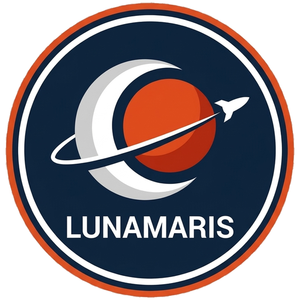

<p align="center">
  
</p>

<h1 align="center">LUNAMARIS: Letters Across the Silent Seas</h1>

<p align="center">
  Trò chơi kể chuyện trên web: bốn cỗ máy NASA bị bỏ lại trên Mặt Trăng và Sao Hỏa "viết thư" về Trạm mặt đất Hà Nội.<br/>
  <b>🚀 Chơi ngay: <a href="https://lunamaris.vercel.app">lunamaris.vercel.app</a></b>
</p>

> Bài dự thi **NASA International Space Apps Challenge 2026** (điểm thi Hà Nội), đề bài *Abandoned but not Forgotten: Storytelling about NASA's Discarded Equipment on the Moon and Mars*.

---

## Dự án giải quyết gì?

Tài liệu của NASA gần như toàn tiếng Anh, số liệu khó hình dung, và người đọc khó biết nguồn nào đáng tin. LUNAMARIS biến những số liệu đó thành một câu chuyện có trò chơi, để **học sinh 11–15 tuổi** tự khám phá, và để **giáo viên KHTN/Vật lý** có sẵn một bài học ngắn.

Thông điệp: *lắng nghe những cỗ máy cũ để biết nên đặt bước chân mới ở đâu*. Người chơi hiểu vì sao các chuyến đổ bộ mới (Artemis) phải đáp xa các di tích cũ.

## Trải nghiệm (khoảng 10 phút)

- **4 cỗ máy, 4 trò chơi nhỏ:** Apollo 11 (gương phản xạ laser), Surveyor 3, xe tự hành Opportunity và trực thăng Ingenuity. Thắng mỗi trò chơi sẽ mở một lá thư của cỗ máy và nhận một **thẻ luật**, tức một bài học về cách bảo vệ di tích.
- **Trò chơi cuối, chọn bãi đáp Artemis:** dùng 4 thẻ luật để loại các vùng không an toàn và chọn vùng cách di tích **ít nhất 2 km**.
- **Thẻ Space Heritage Guardian:** tấm thẻ chứng nhận người chơi tải về được. Thẻ được vẽ ngay trên trình duyệt, không thu thông tin cá nhân.
- **Nút "Hồ sơ Khoa học"** ở mỗi trò chơi: mô phỏng, số liệu thật và nguồn NASA của từng con số.
- **Góc giáo viên** (kế hoạch bài giảng 15 phút) và **trang Nguồn**.
- Song ngữ **Tiếng Việt / English**. Chạy trên điện thoại lẫn máy tính, bằng cảm ứng lẫn chuột và bàn phím.

## Chuyện tưởng tượng và dữ liệu thật

Trang tách rõ hai giọng:

- 📡 **Thư của cỗ máy** là phần văn học, được viết dựa trên dữ liệu thật. Máy móc không thật sự gửi thư.
- 🏛️ **Hồ sơ khoa học** là số liệu đã kiểm chứng từ tài liệu gốc của NASA (NSSDCA, ảnh LRO, JPL, NASA SP-284) và luật bảo vệ di sản *One Small Step* (Public Law 116-275).

| Cỗ máy | Ở đâu | Con số chính trong trò chơi |
| :--- | :--- | :--- |
| Apollo 11 – gương LRRR | Mặt Trăng, Biển Yên Tĩnh | Ánh laser đi về mất khoảng **2,56 giây**; Mặt Trăng lùi xa 3,8 cm mỗi năm |
| Surveyor 3 | Mặt Trăng, Biển Bão Tố | Apollo 12 đáp cách nó khoảng **160 m**, bụi bắn làm rỗ và đổi màu thân máy |
| Opportunity | Sao Hỏa, Thung lũng Perseverance | Bão bụi 2018 làm điện tụt từ **645 xuống 22 Wh** mỗi ngày |
| Ingenuity | Sao Hỏa, hố Jezero | **72 chuyến bay**, tổng **17,0 km**, rồi dừng vì gãy cánh quạt |

## Chạy thử trên máy

Không cần cài đặt hay build. Cách đơn giản nhất là nhấp đúp mở `index.html` trong trình duyệt. Nếu muốn chạy qua server cục bộ:

```bash
python -m http.server 8000   # hoặc: npx serve .
```

Rồi mở `http://localhost:8000`.

Mẹo khi phát triển:

- Vào thẳng một cảnh bằng hash trên URL: `#start`, `#signals`, `#ch1` … `#ch4`, `#artemis`.
- Tiến trình chơi lưu trong `localStorage` (khóa `lunamaris_progress`). Xóa khóa này để chơi lại từ đầu.

**Triển khai:** trang đang chạy trên Vercel. Cập nhật bản chính thức bằng `npx vercel deploy --prod`. File `.vercelignore` loại tài liệu nội bộ (`docs/`, `types/`, `*.docx`) khỏi bản deploy.

## Công nghệ và cấu trúc thư mục

HTML, CSS, JavaScript thuần, không backend. Dùng Tailwind CSS và Google Fonts qua CDN; hình minh họa vẽ bằng SVG, thẻ chứng nhận vẽ bằng Canvas.

```text
├── index.html            # Trang duy nhất, chứa mọi cảnh: truyện, trò chơi, thư, Guardian, Giáo viên, Nguồn
├── css/styles.css        # Toàn bộ giao diện và hiệu ứng
├── js/
│   ├── app.js            # Điều phối chính: tiến trình, trò chơi, thư, thẻ luật, popup Hồ sơ, đổi ngôn ngữ
│   ├── book.js           # Chuyển cảnh, vuốt/phím mũi tên, điều hướng bằng hash trên URL
│   ├── story.js          # Bộ phát các đoạn truyện (chạm để sang câu tiếp)
│   ├── games.js          # 5 trò chơi
│   ├── svg-engine.js     # Hình vẽ SVG và công thức tính của 4 cỗ máy
│   ├── decision-station.js # Sơ đồ bụi bắn khi đổ bộ (trong Hồ sơ Khoa học của Artemis)
│   ├── certificate.js    # Vẽ và tải thẻ Guardian, lá thư thứ năm dưới dạng ảnh PNG
│   ├── data.js           # Dữ liệu 4 cỗ máy và chữ giao diện (VI/EN)
│   ├── flow-data.js      # Lời truyện, cấu hình trò chơi, thẻ luật (VI/EN)
│   └── notebook-qr.js    # Nút mở mã QR sổ tay NotebookLM
├── data/content.json     # Bản JSON của dữ liệu (khớp với js/data.js)
├── assets/               # Logo, ảnh nền cảnh, ảnh truyện, ảnh/video thiết bị, mã QR
├── types/                # Kiểu dữ liệu TypeScript để tham khảo
├── tools/                # Script phụ (tạo ảnh QR)
├── demo/                 # Bản mockup thử nghiệm giao diện
└── docs/                 # Tài liệu nội bộ của nhóm
```

## Tuân thủ luật cuộc thi

1. **Không dùng logo NASA.** Biểu tượng trên trang do nhóm tự vẽ. Ảnh của NASA đều được ghi công.
2. **Không thu dữ liệu người dưới 18 tuổi.** Biệt danh trên thẻ Guardian là tùy chọn, chỉ dùng để vẽ thẻ trên máy người chơi, không lưu và không gửi đi đâu.
3. **Khai báo dùng AI.** Trang ghi rõ công cụ AI đã dùng và quy trình người kiểm lại số liệu với tài liệu gốc.
4. **Tách truyện khỏi dữ liệu.** Phần tưởng tượng và phần số liệu kiểm chứng luôn được gắn nhãn riêng.

## Sổ tay NotebookLM

Toàn bộ nguồn tài liệu NASA nhóm dùng được gom trong một sổ tay NotebookLM:
**[Mở sổ tay NotebookLM](https://notebook.google.com/notebook/1c4fe88f-3774-481e-ac80-15f0992d96da)**


